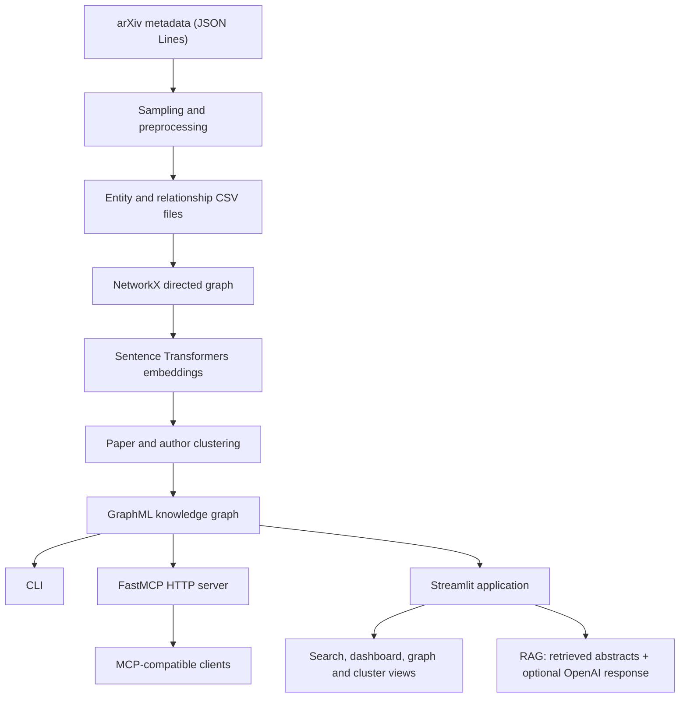

# GraphRAG — Research Paper Knowledge Graph & Retrieval-Augmented Generation

[](https://www.python.org/)
[](https://streamlit.io/)
[](https://gofastmcp.com/)
[](LICENSE)

**GraphRAG** is a Python research prototype that combines a **knowledge graph**, **semantic search**, **graph exploration**, **clustering**, and **retrieval-augmented generation (RAG)** to explore academic publications from [arXiv](https://arxiv.org/).

The project connects research papers, authors, and research categories in a NetworkX graph. It makes that graph accessible through a command-line interface, an HTTP-based **Model Context Protocol (MCP) server**, and an interactive **Streamlit application**.

## Features

- **Knowledge graph:** model papers, authors, arXiv categories, and co-author relationships as a directed graph.
- **Semantic paper search:** rank papers by cosine similarity using Sentence Transformers embeddings.
- **RAG question answering:** retrieve relevant paper titles and abstracts and optionally generate an answer with OpenAI; a context-only mode is also available.
- **Relationship exploration:** inspect paper authors, co-authors, connected topics, and related entities.
- **Clustering:** use K-Means for paper embeddings and K-Means, Louvain, or a hybrid approach for author groups.
- **Interactive visualizations:** explore a graph subnetwork and view cluster plots with Streamlit, streamlit-agraph, and Plotly.
- **MCP integration:** expose graph search, graph statistics, node context, neighbors, clustering, and RAG as callable tools.

## Architecture



### Graph schema

| Entity | Node ID pattern | Information |
| --- | --- | --- |
| Paper | `paper_<arxiv_id>` | Title, abstract, year, arXiv URL, version count, embedding, cluster |
| Author | `author_<name>` | Name, embedding, and available clustering metadata |
| Topic | `topic_<category>` | arXiv category identifier |

| Directed relationship | Meaning |
| --- | --- |
| `Paper → Author` / `AUTHORED_BY` | A paper is associated with an author |
| `Paper → Topic` / `BELONGS_TO` | A paper belongs to an arXiv category |
| `Author → Author` / `COAUTHOR_WITH` | Two authors collaborated on at least one paper |

The graph is stored as **GraphML** and loaded using **NetworkX**, without requiring a separate graph database server.

### Included sample

The repository includes a balanced sample spanning eight broad arXiv research domains: Computer Science, Economics, Electrical Engineering and Systems Science, Mathematics, Physics, Quantitative Biology, Quantitative Finance, and Statistics.

The committed processed CSV files contain:

| Metric | Count |
| --- | ---: |
| Papers | 304 |
| Authors | 811 |
| Research categories | 107 |
| Nodes across these types | 1,222 |

These counts describe the supplied sample, **not** all of arXiv. Search results and generated answers are restricted to the papers available in the loaded graph.

## Tech stack

| Layer | Technologies |
| --- | --- |
| Language and data | Python, Pandas, NumPy |
| Graph | NetworkX, GraphML |
| Text embeddings | Sentence Transformers (`all-MiniLM-L6-v2`) |
| Search | Cosine similarity, scikit-learn |
| Clustering | K-Means, Louvain, PCA, t-SNE |
| RAG | OpenAI API (optional for generation) |
| Integration | FastMCP over HTTP |
| Interface | Streamlit, streamlit-agraph, Plotly |

Paper embeddings are generated from the title and the first 500 characters of the abstract. The `all-MiniLM-L6-v2` model produces 384-dimensional vectors. Author embeddings are calculated by averaging the embeddings of their associated papers, with a name-based fallback.

## Getting started

### 1. Clone and install

Use **Python 3.10+** (Python 3.11 is recommended). Run these commands from the repository root:

```bash
git clone https://github.com/antoniskaraolis/GraphRAG.git
cd GraphRAG

python -m venv .venv
source .venv/bin/activate   # macOS / Linux
# Windows PowerShell: .venv\Scripts\Activate.ps1

python -m pip install --upgrade pip
pip install -r ui/requirements.txt
```

The UI requirements include the core dependencies. For CLI/MCP-only use, `pip install -r requirements.txt` is sufficient.

**Note:** The first semantic search or graph rebuild may download the Sentence Transformers model from Hugging Face.

### 2. Configure environment variables

Create or update a local `.env` file in the repository root:

```dotenv
GRAPH_PATH=data/processed/graph.graphml
HOST=127.0.0.1
PORT=8000
OPENAI_API_KEY=
CACHE_TTL=300
```

- `GRAPH_PATH` points to the saved GraphML file. A prebuilt graph is included in the repository.
- `HOST` and `PORT` configure the MCP HTTP server. `127.0.0.1` is suitable for local use.
- Set `OPENAI_API_KEY` to your own key to enable OpenAI-generated RAG answers. Leave the value empty for context-only exploration, and choose **simple** in the Streamlit RAG page.
- `OPENAI_API_KEY` must be present in the environment or `.env` because the current configuration declares it as a required setting, even when OpenAI generation is not being used.

**Security:** Never publish real API keys or commit a credentials-filled `.env` file. The repository's `.gitignore` excludes `.env` for new, untracked files.

### 3. Launch the Streamlit app

```bash
streamlit run ui/app.py
```

Open the local address printed by Streamlit (typically `http://localhost:8501`).

The application provides five views:

| Page | Purpose |
| --- | --- |
| Dashboard | Graph statistics, quick entity search, recent queries |
| Search | Semantic paper search and text matching for authors/topics |
| Graph Explorer | Interactive node-link graph with entity filters |
| Clustering | Paper/author clusters, size charts, and 2D PCA/t-SNE plots |
| RAG Query | Natural-language questions, evidence papers, graph-based exploration, JSON export |

The Streamlit app reads the graph locally and **does not require the MCP server to be running**.

## Other ways to run the project

### Command-line query interface

```bash
python -m scripts.query_cli
```

The interactive menu offers semantic search, relationship queries, topic-frequency exploration, multi-hop exploration, cluster analysis, and co-author visualization. Run a semantic search first before choosing options that depend on a selected paper.

### MCP server

Start the FastMCP HTTP server from the repository root:

```bash
python scripts/run_mcp_server.py
```

With the example configuration, the MCP endpoint is:

```text
http://127.0.0.1:8000/mcp
```

Run the included MCP client smoke test in another terminal:

```bash
python -m scripts.test_mcp
```

The server exposes **MCP tools**, not conventional REST endpoints:

| Tool name | Function |
| --- | --- |
| `graph/stats` | Count nodes, edges, papers, authors, and topics |
| `graph/search` | Return the top matching papers for a semantic query |
| `graph/neighbors` | Retrieve outgoing neighbors for a node, optionally filtered by relationship |
| `rag/query` | Retrieve paper context and optionally produce an LLM answer |
| `rag/context` | Fetch a node's attributes without its embedding |
| `clusters/list` | Group papers or authors into clusters |
| `clusters/analyze` | Return cluster sizes and available analysis metrics |

Example queries include **“machine learning for statistics”**, **“graph neural networks”**, and **“applications of deep learning in physics”**.

### Rebuild the graph

A preprocessed dataset and GraphML file are already supplied. To recreate the graph from the included raw arXiv metadata:

```bash
python scripts/build_graph.py
```

The build script:

1. Samples research papers across the eight configured domains using a fixed random seed.
2. Extracts paper, author, topic, and relationship CSV files.
3. Constructs a NetworkX directed graph and co-author relationships.
4. Generates sentence embeddings.
5. Performs paper K-Means and hybrid author clustering.
6. Writes the output to `data/processed/graph.graphml`.

Rebuilding can take time depending on the machine and whether the embedding model is cached.

## Repository structure

```text
GraphRAG/
├── graphrag/
│   ├── data_processing.py    # Dataset preparation and CSV extraction
│   ├── graph.py              # Graph construction
│   ├── embeddings.py         # Paper and author representations
│   ├── clustering.py         # K-Means and Louvain clustering
│   └── query.py              # CLI search and exploration logic
├── server/
│   ├── config.py             # Environment-based settings
│   ├── graph_utils.py        # Graph loading and neighbors
│   └── tools/               # MCP graph, RAG, and cluster tools
├── ui/
│   ├── app.py                # Streamlit entry point
│   ├── pages/               # Five UI pages
│   ├── utils.py             # Shared UI operations
│   └── requirements.txt
├── scripts/
│   ├── build_graph.py
│   ├── query_cli.py
│   ├── run_mcp_server.py
│   └── test_mcp.py
├── data/
│   ├── raw/                 # arXiv source sample
│   └── processed/           # Saved graph, sample, and CSVs
├── build_graph.ipynb
├── graphrag_exploration.ipynb
├── requirements.txt
└── LICENSE
```

## Scope and limitations

This is a **research/portfolio implementation**, not a production search service.

- Paper search uses semantic similarity, while author and topic search in the UI uses text matching.
- The current graph explicitly models authorship, arXiv category membership, and co-authorship; it does **not** build a paper-to-paper citation graph.
- The displayed “reasoning path” is based on retrieved papers, shared clusters, and linked authors. It is an exploratory trace rather than a verified explanation of an LLM's internal reasoning.
- LLM output should be checked against the supporting titles, abstracts, and original arXiv papers. The sample is not sufficient for claims about the latest state of scientific research.
- Performance and clustering quality are dependent on the small included sample and the chosen parameters.

## License

Licensed under the [Apache License 2.0](LICENSE).

---

Developed by [Antonis Karaolis](https://github.com/antoniskaraolis) as a practical exploration of **knowledge graphs, semantic retrieval, graph analytics, MCP, and retrieval-augmented generation**.
